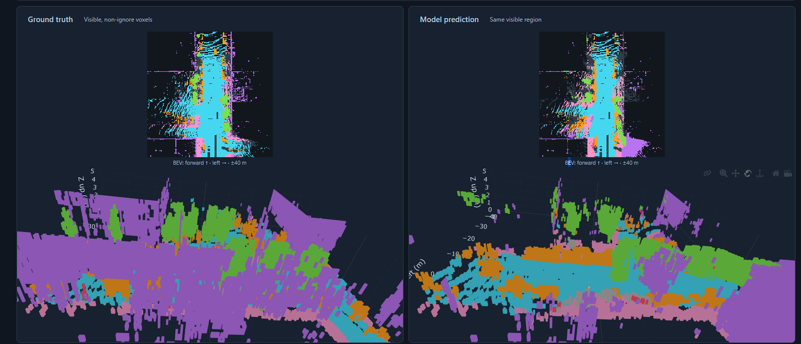

# Camera-only 3D semantic occupancy

A lightweight six-camera model for full 200×200×16 semantic occupancy on nuScenes / Occ3D.
The current geometry-aware variant is inspired by Foundation4D's occupancy representation;
it does not use NVIDIA Foundation4D code or weights.

## 3D semantic occupancy visualization



Ground truth (left) and predictions (right) from the lightweight height-balanced
model at epoch 8, on validation scene `scene-0103`. Both panels show the same
camera-visible, non-ignore voxel region. Colors represent semantic classes.
This full-training result illustrates remaining missing occupied surfaces and
ray smearing; it is not the single-frame overfit demonstration.

The [lightweight implementation](foundation4d/README.md) and
[geometry-aware variant](foundation4d/GEOMETRY.md) document the architecture and
subsequent reconstruction improvements.

## Current training workflow

Run from the project root with the configured dataset and `.venv`:

```powershell
.\foundation4d\run_geometry.ps1 -Epochs 15
```

Resume an existing geometry-aware run:

```powershell
.\.venv\Scripts\python.exe -u -m foundation4d.train `
  --resume foundation4d/outputs/lite_480_geometry_seed0/latest.pt `
  --epochs 15 --workers 2
```

- [Current architecture](foundation4d/GEOMETRY.md)
- [Training, resume and viewer commands](foundation4d/RUNNING.md)
- [Visualization tools](visualization/README.md)
- [Historical experiments and launchers](legacy/README.md)

Datasets, environments and training outputs are local artifacts excluded from Git.
Old model implementations remain available for loading previous checkpoints.

## Development blog

Follow the architecture decisions and experiments at
[BEV-NN — field notes](https://arham-tahir64.github.io/BEV-NN/).
The Astro source is in [blog/](blog/README.md).

## Dataset tools

The root loading, download, extraction and verification scripts remain available.
See the [original dataset-loader guide](legacy/README-original.md) for detailed
nuScenes loading commands and the [historical design notes](legacy/README.md).
