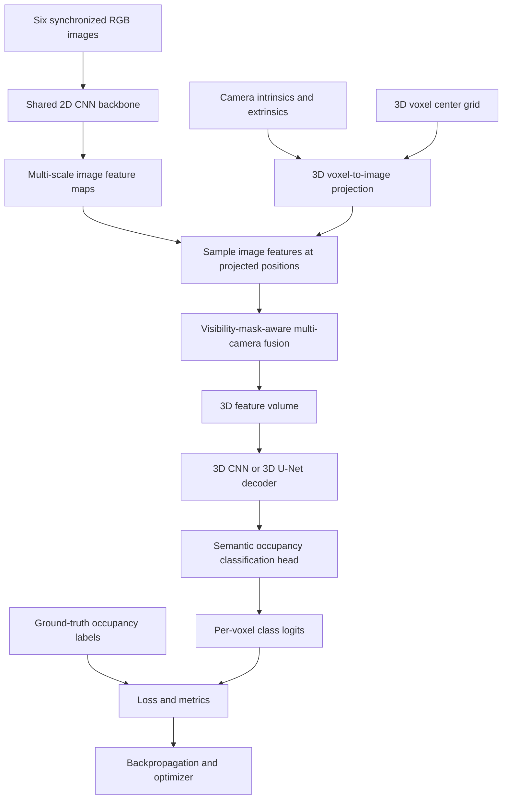

# Camera-Only 3D Semantic Occupancy Prediction

**Status:** Proposed / in development  
**Stack:** Python, PyTorch, nuScenes, torchvision, CUDA, NumPy, Open3D  
**Approach:** SurroundOcc-inspired, six-camera, single-frame semantic occupancy prediction

## 1. Project overview

Build an end-to-end neural network that takes **six synchronized surround-view RGB camera images** and predicts a **voxelized 3D semantic occupancy grid** around an autonomous vehicle. At inference time, the model uses **cameras only**—no LiDAR. LiDAR-derived occupancy annotations may be used during training as ground truth.

Each voxel receives a semantic label, such as free space, vehicle, pedestrian, road, vegetation, or other classes defined by the chosen occupancy annotation set. The precise label mapping must match the dataset.

### Objectives

- Learn spatial features from six RGB cameras with a **shared 2D CNN**.
- Use camera intrinsics and extrinsics to associate image features with positions in a common 3D ego-vehicle frame.
- Fuse evidence from multiple cameras into a 3D feature volume.
- Use a **3D CNN decoder** to predict per-voxel semantic classes.
- Train and evaluate with a compatible nuScenes semantic occupancy label set.
- Visualize predicted voxels, ground truth, and per-class errors.

## 2. Inputs and outputs

| Item | Example shape | Description |
|---|---|---|
| RGB images | `[B, 6, 3, H, W]` | Six synchronized images per sample |
| Camera intrinsics | `[B, 6, 3, 3]` | Pixel projection matrices, adjusted for image resizing/cropping |
| Ego-to-camera transforms | `[B, 6, 4, 4]` | Rigid transformations into each camera frame |
| CNN feature maps | `[B, 6, C, h, w]` | Shared-backbone image features |
| Fused voxel features | `[B, C, X, Y, Z]` | One feature vector per voxel |
| Occupancy logits | `[B, K, X, Y, Z]` | Unnormalized scores for `K` semantic classes |
| Predicted labels | `[B, X, Y, Z]` | `argmax` over class logits |

`B` = batch size; `C` = feature channels; `K` = number of semantic classes. Tensor layouts must be consistent throughout the codebase.

### Prototype configuration (not an official SurroundOcc configuration)

- Images: `320 × 576`
- Backbone: pretrained ResNet-18 with a projection layer to 64 channels
- Grid: `80 × 80 × 12` = **76,800 voxels**
- Spatial range: X/Y `[-40, 40]` metres; Z `[-3, 9]` metres
- Resolution: **1 metre per voxel**
- Classes: use the selected occupancy dataset's class mapping; **18 is only an illustrative placeholder**
- Fusion: geometric projection + masked mean
- Decoder: small 3D CNN, later upgraded to 3D U-Net
- Optimizer: AdamW; learning rate `1e-4`; weight decay `0.01` as initial tuning candidates

## 3. System architecture



### How many neural networks?

The **baseline is one end-to-end trainable model with two learned CNN components**:

1. **One shared 2D CNN backbone**, run on all six cameras using the **same weights** (not six independent CNNs).
2. **One 3D CNN decoder**, followed by a small semantic classification head.

The initial camera projection and masked averaging are geometric operations, **not a separate neural network**. A later attention-based fusion module adds a third learned component.

## 4. Component details

### 4.1 Dataset and preprocessing

Load all six camera images, camera calibration, ego pose where necessary, and dense semantic occupancy labels. Standard nuScenes detection annotations alone are **not** dense occupancy labels; use an additional compatible occupancy dataset/annotation pipeline.

- Keep camera order fixed across all samples.
- Normalize RGB images using the backbone's expected preprocessing.
- Resize or crop consistently and update the camera intrinsics accordingly.
- Express all 3D points and occupancy labels in the **same ego coordinate frame and timestamp**.
- Preserve unknown/unobserved/ignore labels rather than automatically treating them as free space.
- Split training and validation by the prescribed dataset split, not randomly by adjacent frames.

### 4.2 Shared 2D CNN backbone

A pretrained ResNet extracts spatial feature maps from each camera. Flatten the camera dimension into the batch dimension for efficient execution:

```python
# images: [B, 6, 3, H, W]
B, N, _, H, W = images.shape
features = backbone(images.reshape(B * N, 3, H, W))
# backbone output: [B*6, C, h, w]
_, C, h, w = features.shape
features = features.reshape(B, N, C, h, w)
```

Use a feature pyramid network (FPN) later to capture multiple scales.

### 4.3 Camera geometry: project voxels into images

For a voxel center `P_ego = [x, y, z, 1]`, transform into camera coordinates:

```text
P_cam = T_ego_to_cam @ P_ego
q = K @ P_cam[:3]
u = q[0] / q[2]
v = q[1] / q[2]
```

Only sample points with **positive camera depth** and projected coordinates inside the image. Scale projected pixel coordinates into the feature-map coordinate system and use bilinear interpolation (`torch.nn.functional.grid_sample`). Be consistent about `align_corners` and pixel-center conventions.

**Limitation:** A projected voxel being inside the image does not prove it is visible. Multiple depths along the same camera ray can sample the same feature; learned 3D reasoning and later depth-aware/occlusion-aware fusion are needed to reduce this ambiguity.

### 4.4 Six-camera feature fusion

For voxel `v`, let `f_c(v)` be its sampled feature from camera `c` and `m_c(v)` indicate a valid projection:

```text
F(v) = sum_c m_c(v) * f_c(v) / max(1, sum_c m_c(v))
```

This creates a `[B, C, X, Y, Z]` tensor. If no camera projects to a voxel, its initial fused feature is zero; this does **not** mean the voxel is empty.

Later improvements: learned per-camera attention, depth distributions, spatial cross-attention, multi-scale sampling, and explicit visibility modeling.

### 4.5 3D CNN decoder and occupancy head

The decoder processes neighboring voxels and predicts a class logit vector for every voxel:

```python
import torch.nn as nn

class OccupancyDecoder(nn.Module):
    def __init__(self, channels=64, classes=18):
        super().__init__()
        self.net = nn.Sequential(
            nn.Conv3d(channels, 64, 3, padding=1),
            nn.BatchNorm3d(64),
            nn.ReLU(inplace=True),
            nn.Conv3d(64, 32, 3, padding=1),
            nn.ReLU(inplace=True),
            nn.Conv3d(32, classes, 1),
        )

    def forward(self, volume):
        return self.net(volume)  # [B, classes, X, Y, Z]
```

This is a minimal convolutional decoder, **not yet a full U-Net**. A full 3D U-Net would introduce multi-resolution encoder/decoder blocks and skip connections.

## 5. Example model interface

```python
import torch.nn as nn

class CameraOccupancyModel(nn.Module):
    def __init__(self, backbone, fusion, decoder):
        super().__init__()
        self.backbone = backbone
        self.fusion = fusion
        self.decoder = decoder

    def forward(self, images, intrinsics, ego_to_cam):
        B, N, C, H, W = images.shape
        image_features = self.backbone(images.reshape(B * N, C, H, W))
        _, F, h, w = image_features.shape
        image_features = image_features.reshape(B, N, F, h, w)
        volume = self.fusion(image_features, intrinsics, ego_to_cam)
        return self.decoder(volume)
```

The `fusion` implementation is a required module and must implement voxel generation, camera projection, feature sampling, valid masks, and aggregation. The snippet above illustrates the intended interfaces rather than a complete runnable system.

## 6. Loss, gradients, and training

Start with masked per-voxel semantic cross-entropy:

```python
import torch.nn as nn

criterion = nn.CrossEntropyLoss(ignore_index=255)
# logits: [B, K, X, Y, Z]
# labels: [B, X, Y, Z]
loss = criterion(logits, labels)
```

The ignore index must match the annotation format. Consider class weights for class imbalance and optional auxiliary occupancy or Lovasz-style losses after establishing a baseline.

Training step:

```python
optimizer.zero_grad(set_to_none=True)
logits = model(images, intrinsics, ego_to_cam)
loss = criterion(logits, labels)
loss.backward()
optimizer.step()
```

Backpropagation computes gradients through the 3D decoder, fusion sampling, and 2D backbone. The camera matrices are ordinarily fixed inputs rather than trainable weights.

Recommended engineering practices: automatic mixed precision where supported, gradient clipping if needed, checkpointing, validation each epoch, fixed seeds, and logging loss, IoU, memory usage, and training throughput.

## 7. Evaluation

Measure:

- **Semantic mean IoU (mIoU)** across the designated classes.
- **Per-class IoU**, especially vehicles, pedestrians, road, and small objects.
- **Binary occupancy IoU**, if meaningful under the label convention.
- Qualitative 3D predictions versus ground truth.
- Runtime, GPU memory, and throughput.

Avoid including ignored or unobserved voxels in metrics unless the benchmark specifies otherwise. Keep voxel bounds, semantic mapping, and evaluation masks identical across model variants.

## 8. Proposed repository structure

```text
camera-occupancy/
├── configs/
│   ├── baseline.yaml
│   └── attention.yaml
├── datasets/
│   ├── nuscenes_dataset.py
│   ├── occupancy_labels.py
│   └── transforms.py
├── models/
│   ├── occupancy_model.py
│   ├── backbones/
│   │   ├── resnet.py
│   │   └── fpn.py
│   ├── geometry/
│   │   ├── camera.py
│   │   ├── projection.py
│   │   └── voxel_grid.py
│   ├── fusion/
│   │   ├── voxel_sampling.py
│   │   ├── camera_fusion.py
│   │   └── spatial_attention.py
│   ├── decoders/
│   │   ├── unet3d.py
│   │   └── occupancy_head.py
│   └── losses/
│       └── occupancy_loss.py
├── engine/
│   ├── trainer.py
│   ├── evaluator.py
│   └── metrics.py
├── utils/
│   ├── visualization.py
│   └── checkpoint.py
├── scripts/
│   ├── prepare_data.py
│   ├── train.py
│   ├── evaluate.py
│   └── infer.py
├── tests/
│   ├── test_projection.py
│   ├── test_fusion.py
│   └── test_model.py
├── data/                  # ignored by git
├── checkpoints/           # ignored by git
├── outputs/               # ignored by git
├── pyproject.toml
└── README.md
```

A mature research-style version may contain approximately **25–35 Python files and 3,000–6,000 lines of code**, but a first functioning baseline should be smaller.

## 9. Implementation roadmap

### Phase 1 — Data and camera geometry

- [ ] Install PyTorch, nuScenes devkit, and visualization dependencies.
- [ ] Download nuScenes samples and compatible semantic occupancy annotations.
- [ ] Visualize all six synchronized camera views.
- [ ] Implement voxel-grid generation.
- [ ] Verify 3D-to-2D projection with known 3D points and calibration matrices.
- [ ] Unit-test camera-frame conversions and resized intrinsics.

**Exit criterion:** Voxel/3D points project correctly into all relevant camera images.

### Phase 2 — Baseline model

- [ ] Implement shared ResNet-18 backbone.
- [ ] Implement batched feature sampling with `grid_sample`.
- [ ] Implement projection masks and masked camera averaging.
- [ ] Implement 3D CNN decoder and classification head.
- [ ] Verify all tensor shapes with synthetic data.
- [ ] Overfit a tiny subset to check the end-to-end learning path.

**Exit criterion:** Model runs forward/backward and learns on a tiny dataset.

### Phase 3 — Full training and evaluation

- [ ] Implement semantic cross-entropy and label masks.
- [ ] Train on a proper training split.
- [ ] Evaluate mIoU and per-class IoU on validation scenes.
- [ ] Render predicted and ground-truth occupancy volumes.
- [ ] Save reproducible configs and checkpoints.

**Exit criterion:** Quantitative results and qualitative 3D visualizations are reproducible.

### Phase 4 — Research extensions

- [ ] Upgrade to multi-scale CNN/FPN features.
- [ ] Compare masked mean fusion with learned camera attention.
- [ ] Add a multi-resolution 3D U-Net decoder.
- [ ] Experiment with depth-aware and occlusion-aware fusion.
- [ ] Conduct ablations on grid resolution, fusion, backbone, and losses.

**Exit criterion:** Report measurable improvements and clear trade-offs over the baseline.

## 10. Important technical risks

1. **Depth ambiguity:** Camera-only features do not directly determine which 3D depth along a ray is occupied.
2. **Calibration mismatch:** Incorrect transforms or unadjusted intrinsics will misalign features.
3. **Occlusion and unobserved space:** Out-of-view or occluded voxels must not be casually labeled free.
4. **Dataset-label mismatch:** Grid bounds, axes, class IDs, and ignore masks must match the annotation source.
5. **Memory cost:** Dense 3D feature volumes and 3D CNN activations can quickly exhaust VRAM.
6. **Evaluation leakage:** Adjacent nuScenes frames are highly correlated; use proper dataset splits.

## 11. Deliverables

- End-to-end camera-only semantic occupancy model in PyTorch.
- Clear geometric projection and fusion implementation with unit tests.
- Reproducible training and evaluation scripts.
- Predicted vs. ground-truth 3D voxel visualizations.
- Baseline and attention-fusion comparison, if time permits.
- A technical report covering architecture, metrics, ablations, limitations, and lessons learned.

## 12. References

- [nuScenes dataset](https://www.nuscenes.org/)
- [nuScenes tutorial](https://www.nuscenes.org/tutorials/nuscenes_tutorial.html)
- [SurroundOcc paper](https://arxiv.org/abs/2303.09551)
- [SurroundOcc reference implementation](https://github.com/weiyithu/SurroundOcc)
- [PyTorch documentation](https://pytorch.org/docs/stable/index.html)

---

**Core design principle:** Begin with a geometrically correct, minimal camera-only occupancy baseline. Add attention and architectural complexity only after validating the projections, labels, and training loop.
